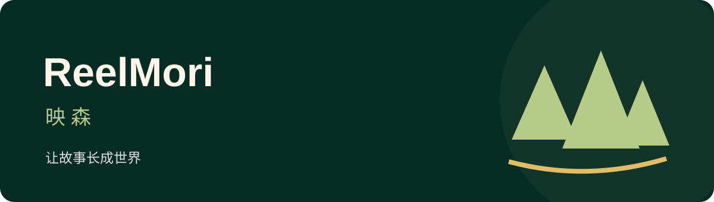

### 让故事长成世界

**AI 动画 · 漫剧 · 影像叙事**

## 我们的创作方向

从角色、场景到完整故事，探索 AI 动画与漫剧的创作过程，让每一段影像拥有连贯的世界与情绪。

| 方向 | 探索内容 |
| --- | --- |
| 故事世界 | 世界观、角色设定、场景与视觉风格 |
| 动画与漫剧 | 剧本分镜、镜头生成与连续叙事 |
| 制作工具 | 角色和画面一致性工作流、素材组织与后期编排 |

## 一起开始创作

项目正在起步，我们会结合实际创作逐步整理并发布 Skills、工作流和工具。

欢迎关注组织仓库，在具体项目的 Issue 中交流创意、使用体验和改进建议。
